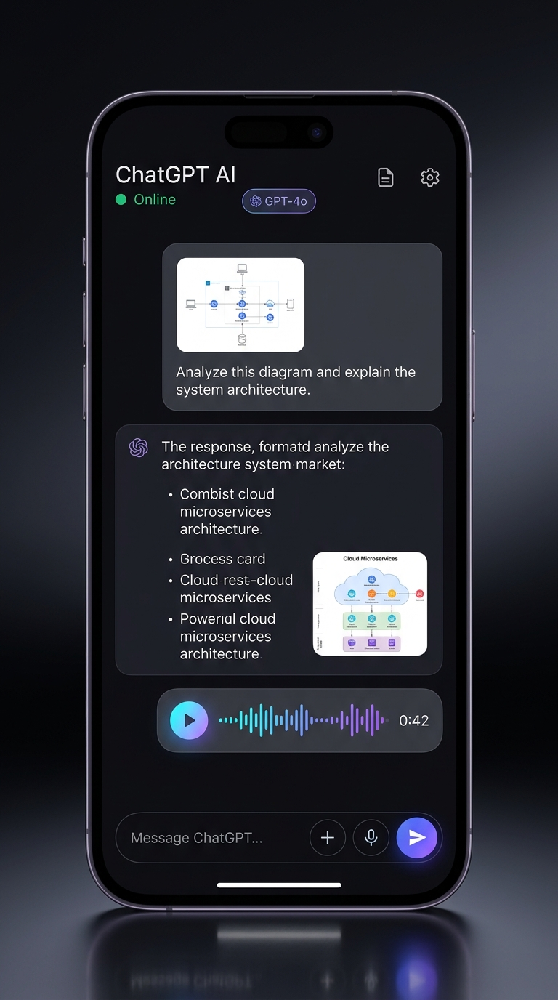
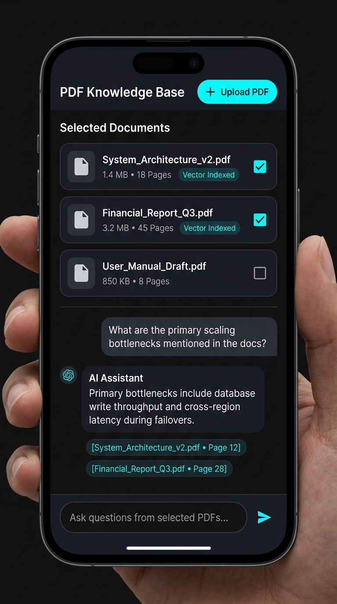

# 📱 ChatGPT-like Flutter AI Client (GetX Architecture)

A modern, high-performance Flutter application replicating **ChatGPT** with real-time Multimodal intelligence (Vision, Audio STT/TTS, DALL-E) and an isolated **PDF-RAG Knowledge Base**.

**Main Repository**: [https://github.com/pratham-singh-14/AI_Chat_Bot_Clone.git](https://github.com/pratham-singh-14/AI_Chat_Bot_Clone.git)

---

## 🎨 UI Showcase

<div align="center">

| Multimodal Chat | PDF-RAG Knowledge Base |
| :---: | :---: |
|  |  |

</div>

---

## 🏗 Architecture Overview

The app follows **Clean Layered Architecture** with strict **GetX state management**:
* **`lib/core/`**: Material 3 theming (light & dark), Dio HTTP client with custom error mapping, auto-detecting base URL (`10.0.2.2:8080` for emulator vs `localhost:8080`), and session manager.
* **`lib/data/`**: Models with `fromJson`/`toJson`, repositories, and API services.
* **`lib/modules/`**: Feature modules containing `Binding`, `Controller`, `View`, and custom widgets:
  * `chat_list`: Conversations list with swipe-to-delete.
  * `chat`: Multimodal chat with photo attachments, voice recording, DALL-E generation, and audio waveform playback.
  * `pdf_chat`: Multi-document selection with checkboxes, PDF upload, and isolated vector RAG with citation chips.
* **`lib/routes/`**: Centralized named routes and GetPage definitions.

---

## ⚡ Zero-setState Rule & Reactive State Management

1. **No `setState`**: The entire UI is purely reactive using GetX observables (`.obs`) and `Obx(() => ...)` listener widgets.
2. **Memory Safety**: Controllers are lazily injected via `Bindings` using `Get.lazyPut(...)` and automatically disposed when route views pop from the navigation stack.
3. **Decoupled Business Logic**: Widgets are purely presentational; all API requests, audio recording, and error handling live inside controllers.

---

## 🚀 Running the App

```bash
# 1. Install dependencies
flutter pub get

# 2. Run static analysis (0 warnings, 0 errors)
flutter analyze

# 3. Run automated tests (9/9 passed)
flutter test

# 4. Launch on device or emulator
flutter run

# 5. Build debug APK
flutter build apk --debug
```
*Compiled APK location*: `build/app/outputs/flutter-apk/app-debug.apk`.
